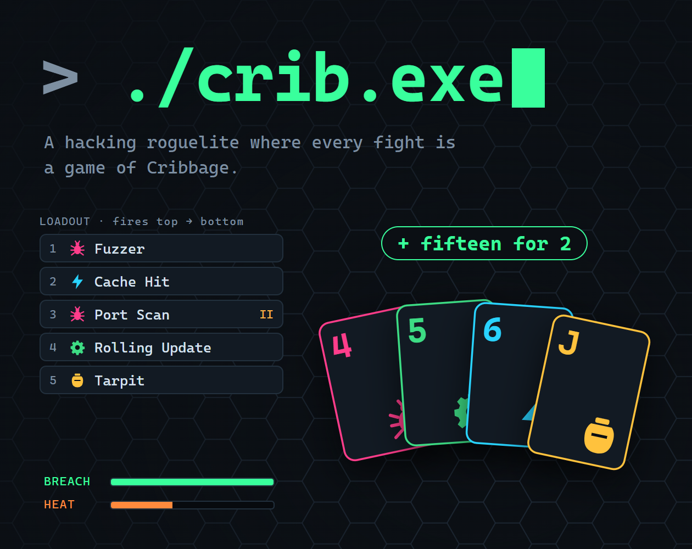
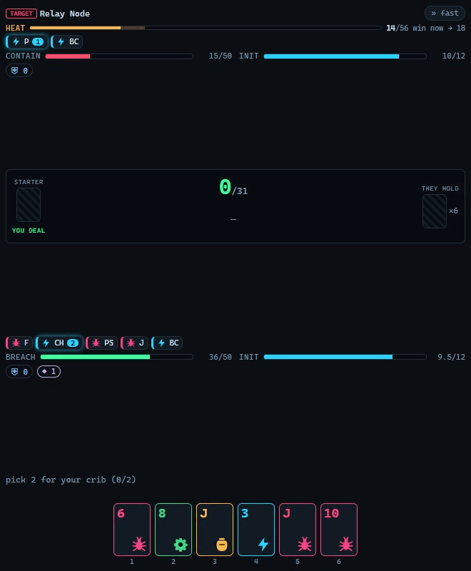
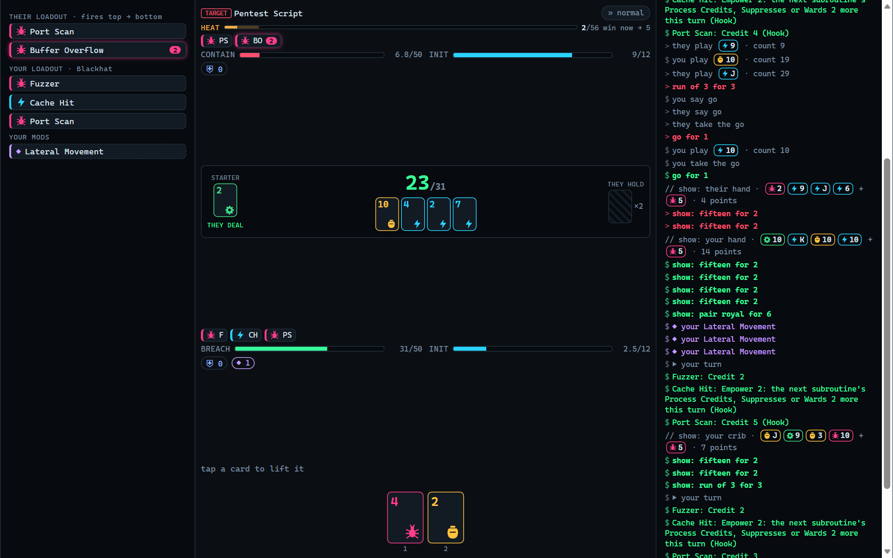
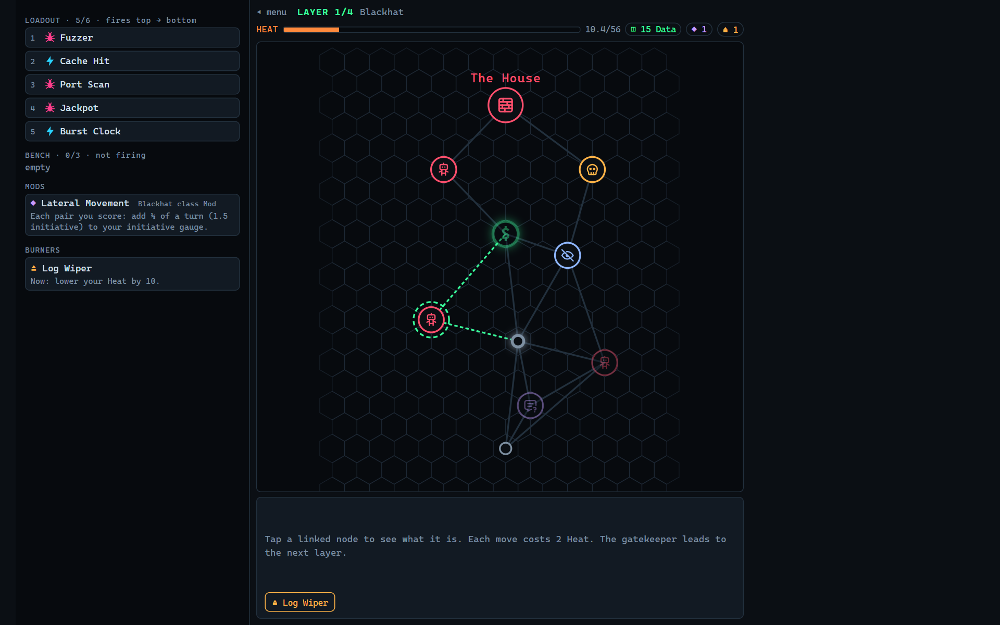
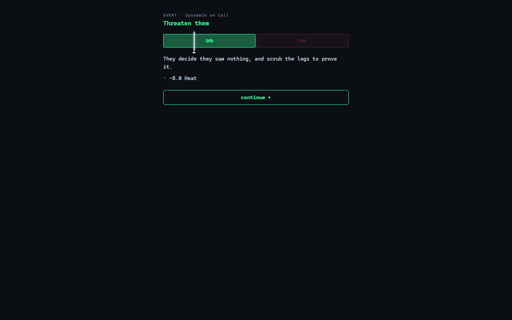
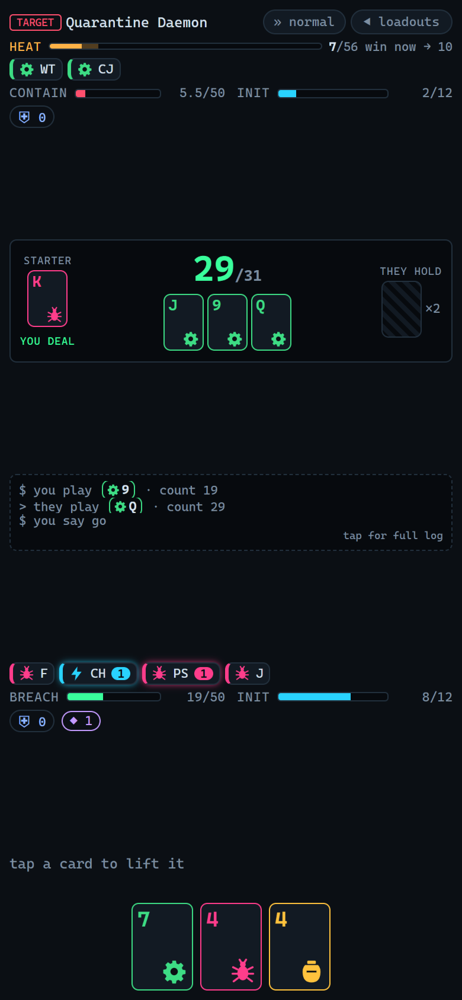
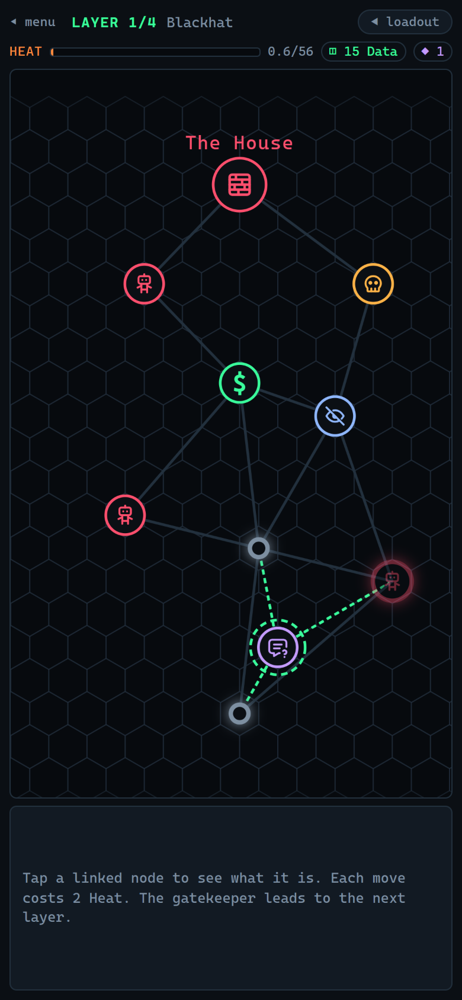
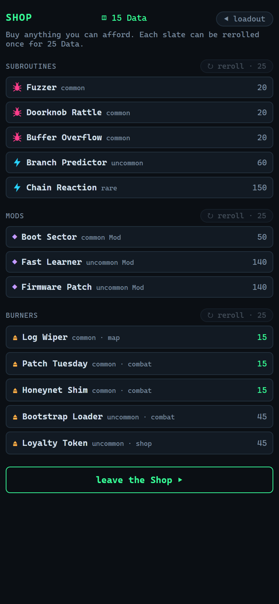
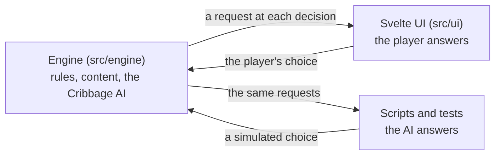

<p align="center">
  
</p>

<h1 align="center">crib.exe</h1>

<p align="center">
  <b>A hacking roguelite where every fight is a game of Cribbage.</b><br>
  <a href="https://cribexe.com">Play at cribexe.com</a> ·
  <a href="https://rhapsydian.itch.io/cribexe">itch.io</a> ·
  <a href="https://discord.gg/HxCry3uRpa">Discord</a><br>
  Release candidate v0.9.1 · free in the browser, on desktop and phones
</p>

<p align="center">
  
</p>

## What it is

You're a hacker breaking into a network four layers deep. Each layer is a
branching map of fights, Shops, Quiet Hosts, Caches and Events, with a
gatekeeper guarding the way down, and every move raises your Heat. Max it
out and you're traced.

Every fight is a real game of Cribbage against the system you're breaking
into. The points you score in pegging, your hand and your crib fill your
initiative, and when it fills you take a turn: every subroutine in your
loadout fires, top to bottom, building your Breach. Fill it before the
enemy's subroutines fill its Containment. Between fights you pick up new
subroutines and order them so they feed each other, add Mods that bend
the rules for the rest of the run, and carry one-use Burners for when a
fight turns. Cribbage skill still decides fights, by design: better play
means more turns.

## Screenshots

<p>
  
  
  
</p>
<p>
  
  
  
</p>

## Features

- **6 classes**, each pairing two archetypes, with its own class Mod and
  starting loadout, unlocking one after another
- **52 subroutines** across four archetypes, each bound to a suit:
  Exploit, Daemon, Overclock and Honeypot
- **57 Mods**, from small bumps to rule-benders and double-edged bargains;
  **24 Burners** and **24 Events**, each with a story
- **49 enemies**: regulars, elites with a Mod of their own, and
  gatekeepers that each bend a rule
- **Progression between runs:** Rep, upgrades, a subroutine library and
  ten Security Levels
- **A Daily Run:** the same class and twists for everyone, one scored
  attempt a day
- **A guided tutorial**, and a review coach that rates your Cribbage play
  in stars
- **Plain Cribbage** too: four difficulty levels, a coach, and five short
  lessons for new players

## How it's built

**Svelte 5, TypeScript and Vite**, tested with **Vitest**, with no game
engine: everything (cards, the map, the gauges) is SVG and DOM. It's a
turn-based game, so a canvas engine would be overhead without payoff.

**A headless engine with a thin UI.** All the game's rules live in
`src/engine/`, plain TypeScript with no browser dependency. The Svelte UI
in `src/ui/` only renders the engine's state and passes the player's
choices back.

**The engine pauses at every decision.** A run, a fight and a game of
Cribbage are generators that yield a request at each decision (a discard,
a pegging play, a reward pick, a move) and resume with the answer. The
same code runs in the browser, where the player answers, and headless,
where the AI or a scripted strategy answers. A save is just the seed and
the list of answers, replayed.



**One Cribbage AI.** A single tunable-skill evaluator, with one 0-1 knob
blending novice and expert weights, plays every enemy, gives the coach
its judgement, rates the player's play and drives the simulated player.
Nothing in the UI second-guesses it.

## Balance measured, not guessed

Because the engine runs headless, every subroutine, Mod, Burner and enemy
was priced and tuned by simulation:

- **One currency.** Content is priced in Credit per turn by
  seat-swapped mirror duels, so a Ward and a Credit can be compared
  directly, and enemies share the player's prices.
- **Whole runs, not isolated fights.** Changes were checked across
  hundreds of simulated runs per class against set targets: 24-30% of
  runs won by a fresh player, every class within about 3 points of the
  average, and Heat ending about 12% of runs.
- **Skill must still matter.** A check that a loadout doesn't drown out
  Cribbage skill guards every class's starting kit.

The 41 measurement scripts and the conventions for reading their numbers
are in [docs/tools.md](docs/tools.md); raw output from the bigger passes
is in [docs/calibration/](docs/calibration/README.md).

## How it was made

crib.exe was designed and directed by Justin Stephens and built with
[Claude Code](https://claude.com/claude-code), Anthropic's agentic coding
tool, over 75 working sessions from August to October 2026. Every design
decision was made in conversation, one question at a time, and written
down as it was settled. The decision records are in
[docs/design/](docs/design/), the settled design in [DESIGN.md](DESIGN.md),
and each session's goals, choices and results in
[docs/session-logs/](docs/session-logs/README.md).

## Running it locally

Needs Node 22.

```bash
npm install
npm run dev      # the dev server
npm test         # the Vitest suite
npm run check    # svelte-check and tsc across the app, its config and the scripts
npm run build    # the production build, in dist/
npm run preview  # serve that build
```

`playable` deploys to cribexe.com on every push
(`.github/workflows/deploy-demo.yml`); itch.io builds go up by hand
([docs/itch/page.md](docs/itch/page.md)).

## Documentation

| File | Holds |
|---|---|
| [DESIGN.md](DESIGN.md) | The settled design and the reasoning behind it |
| [docs/](docs/README.md) | Design records, release work, measurements, session logs and the archive |
| [BACKLOG.md](BACKLOG.md) | What's still to do |
| [PATCH_NOTES.md](PATCH_NOTES.md) | Unreleased changes and the latest release's notes |
| [docs/tools.md](docs/tools.md) | The balance and diagnostic scripts |

## License and credits

Copyright © 2026 Justin Stephens. All rights reserved. The source is
published to read; see [LICENSE](LICENSE).

Icons: [Tabler Icons](https://tabler.io/icons) (MIT). Card sounds:
Keyboard soundpack 1 by unicaegames (CC0).
